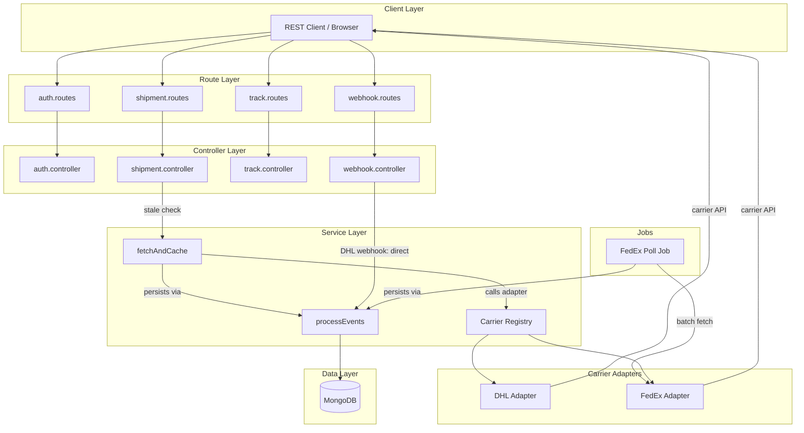

# SwiftEx Backend — Implementation Walkthrough

## Summary

Built a complete, production-ready carrier-agnostic tracking backend with **35 files**, **57 passing unit tests**, and full separation of concerns.

---

## Architecture Overview



---

## Key Design Decisions

### 1. `processEvents` / `fetchAndCache` Split (Your Fix)

The core tracking pipeline is split into two functions per your specification:

| Function | What it does | Who calls it |
|---|---|---|
| [processEvents](file:///c:/Users/PETER/Desktop/Dev%20Work/log/Backend/src/services/tracking/processEvents.js) | Dedup → upsert events → update `lastFetchedAt` → rollup recalc → save. **No carrier API call.** | DHL webhook handler, `fetchAndCache` internally |
| [fetchAndCache](file:///c:/Users/PETER/Desktop/Dev%20Work/log/Backend/src/services/tracking/fetchAndCache.js) | Calls `adapter.fetchTracking()` → normalises → delegates to `processEvents` | FedEx poll job, on-demand freshness check |

**DHL webhook flow**: verify sig → parse payload → `processEvents(shipment, normalizedEvents)` → 200 OK. Zero redundant API calls.

### 2. Internal Tracking ID Abstraction

- Every shipment gets a `SWX-XXXXXXXX` ID ([generator](file:///c:/Users/PETER/Desktop/Dev%20Work/log/Backend/src/utils/generateTrackingId.js)) auto-assigned via pre-save hook
- Public endpoint (`GET /track/:id`) strips `carrierTrackingNumber`, `rawCarrierPayload`, and all internal fields ([track.controller](file:///c:/Users/PETER/Desktop/Dev%20Work/log/Backend/src/controllers/track.controller.js))
- Carrier details never leak to public consumers

### 3. Carrier Adapter Strategy Pattern

- Common interface enforced at registration time ([adapter.interface](file:///c:/Users/PETER/Desktop/Dev%20Work/log/Backend/src/services/carriers/adapter.interface.js))
- Registry + factory pattern ([registry.js](file:///c:/Users/PETER/Desktop/Dev%20Work/log/Backend/src/services/carriers/registry.js))
- Adding a new carrier = one adapter file + one `registerAdapter()` call. Zero changes to core logic.

### 4. Caching / Rate-Limit Protection

- MongoDB is source of truth for reads
- Terminal statuses (`DELIVERED`, `CANCELLED`, `RETURNED`) → never re-fetch
- Non-terminal + stale (`lastFetchedAt` > threshold) → `fetchAndCache` on demand
- DHL shipments skip freshness checks — UTAPI push keeps them current

---

## File Structure

```
src/
├── __tests__/
│   ├── eventDedup.test.js          # 8 tests
│   ├── rollup.test.js              # 14 tests
│   └── statusNormalization.test.js # 35 tests
├── config/
│   └── index.js
├── controllers/
│   ├── auth.controller.js
│   ├── shipment.controller.js
│   ├── track.controller.js
│   └── webhook.controller.js
├── jobs/
│   └── fedexPollJob.js
├── middleware/
│   ├── auth.js
│   ├── errorHandler.js
│   ├── rateLimiter.js
│   └── validate.js
├── models/
│   ├── Shipment.js
│   └── User.js
├── routes/
│   ├── auth.routes.js
│   ├── shipment.routes.js
│   ├── track.routes.js
│   └── webhook.routes.js
├── services/
│   ├── carriers/
│   │   ├── adapter.interface.js
│   │   ├── registry.js
│   │   ├── dhl/
│   │   │   ├── dhl.adapter.js
│   │   │   ├── dhl.statusMap.js
│   │   │   └── dhl.webhook.js
│   │   └── fedex/
│   │       ├── fedex.adapter.js
│   │       ├── fedex.auth.js
│   │       └── fedex.statusMap.js
│   └── tracking/
│       ├── eventHash.js
│       ├── fetchAndCache.js
│       ├── processEvents.js
│       ├── rollup.js
│       └── status.enum.js
├── utils/
│   ├── AppError.js
│   ├── generateTrackingId.js
│   ├── jwt.js
│   └── logger.js
├── app.js
└── server.js
```

---

## Test Results

```
Test Suites: 3 passed, 3 total
Tests:       57 passed, 57 total
```

| Suite | Tests | Coverage |
|---|---|---|
| Status Normalization | 35 | DHL + FedEx maps, null handling, case insensitivity, unmapped fallback |
| Multi-Leg Rollup | 14 | No-leg, single-leg, escalation, final-leg-delivered, active-leg resolution, ordering |
| Event Dedup | 8 | Hash determinism, field sensitivity, Date objects, idempotent insertion simulation |

---

## How to Run

```bash
# 1. Copy env template and configure
cp .env.example .env

# 2. Install dependencies (already done)
npm install

# 3. Start dev server (requires local MongoDB)
npm run dev

# 4. Run tests
npm test
```

## API Endpoints

| Method | Path | Auth | Description |
|---|---|---|---|
| `POST` | `/auth/register` | — | Register a new user |
| `POST` | `/auth/login` | — | Login, get token pair |
| `POST` | `/auth/refresh` | — | Rotate refresh token |
| `GET` | `/auth/me` | Bearer | Get current user |
| `POST` | `/shipments` | Bearer | Create shipment |
| `GET` | `/shipments` | Bearer | List shipments (scoped) |
| `GET` | `/shipments/:id` | Bearer | Full shipment detail + freshness check |
| `POST` | `/shipments/:id/poll` | Admin | Manual carrier poll trigger |
| `GET` | `/track/:id` | — | Public sanitised tracking |
| `POST` | `/webhooks/dhl` | DHL sig | DHL UTAPI push receiver |
| `GET` | `/health` | — | Health check |
